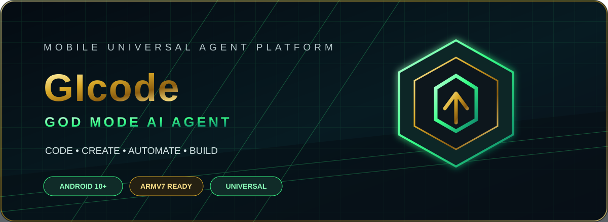
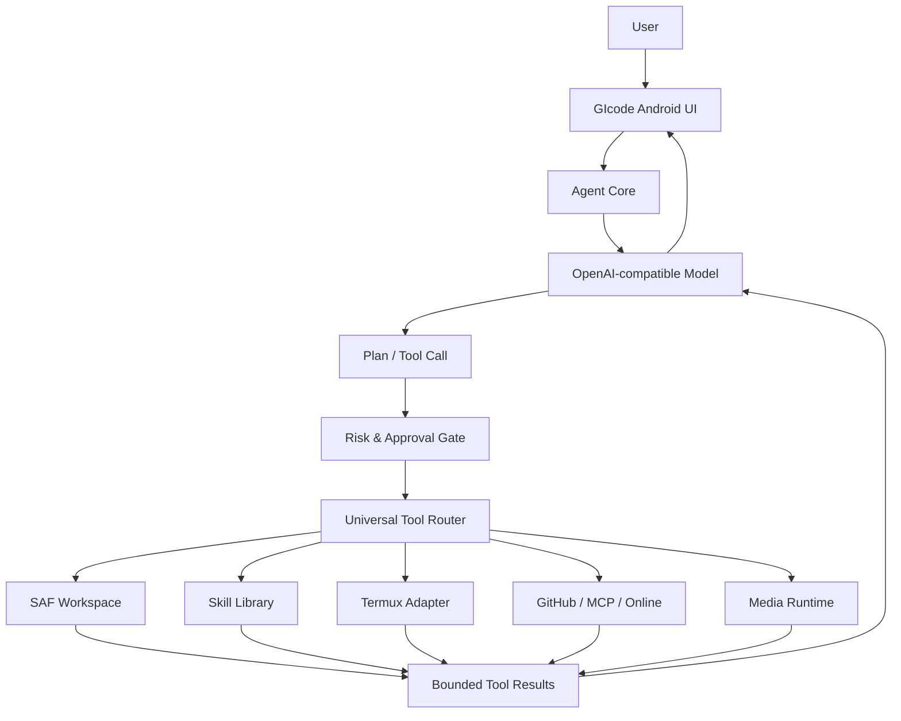

# GIcode — GOD MODE AI AGENT

### Your Android-first AI command center.

**AI Chat · Agent Modes · Skills · Universal Tools · Workspace · Termux · MCP-ready Architecture**

[Download Releases](https://github.com/gikoko611/GI-CODE/releases) · [Build Status](https://github.com/gikoko611/GI-CODE/actions) · [Report an Issue](https://github.com/gikoko611/GI-CODE/issues)

---

## ◈ About GIcode

GIcode is an Android-first AI agent workspace designed to bring coding assistance, project workflows, device-aware tools and extensible skills into one mobile application.

It combines an OpenAI-compatible model interface with a local workspace, a skill library and a permission-aware Universal Tool System. The architecture is designed for gradual expansion: tools are only advertised as executable when their runtime adapter is actually connected.

> **Honest capability note:** A registered tool or installed skill does not automatically mean its runtime is available. Check the in-app tool status and the release notes for what is operational in each build.

## ◈ Device Editions

| Edition | Supported devices | ABI target | Install package |
|---|---|---|---|
| **Redmi 9A Edition** | Redmi 9A / Android 10+ | `armeabi-v7a` only | `com.gikoko.gicode.redmi9a` |
| **Universal Edition** | Android 10+ devices | ARMv7, ARM64, x86, x86_64 package filters | `com.gikoko.gicode.universal` |

- Choose **Redmi 9A Edition** for the Redmi 9A (32-bit ARMv7).
- Choose **Universal Edition** for other supported Android devices.
- The two editions use different application IDs, so they can be installed side-by-side.
- Universal ABI filters describe packaged native-library targets; compatibility still depends on Android version, device architecture and any native libraries used by future features.

## ◈ Feature Matrix

| Module | Current capability |
|---|---|
| AI Chat | OpenAI-compatible `/chat/completions` provider |
| Model discovery | Dynamic `/models` lookup |
| Agent modes | Ask, Plan, Code, Debug, Review, Refactor |
| Skill Library | Bundled, imported and locally installed `SKILL.md` |
| Online Skill Registry | Search, review and install supported SkillMD entries |
| Workspace | SAF folder access, list, read, search, write and delete flows |
| History | Local SQLite chat history |
| Secret storage | Android Keystore-backed encrypted secret storage |
| Universal Tool System | Tool registry, risk levels, approval gate and audit records |
| Termux | App handoff; direct command runtime requires a separate bridge |
| MCP / GitHub / Media | Extensible integration points; runtime status must be checked in-app |
| Blender | Blender scripting guidance; local rendering requires an installed Blender runtime |

## ◈ Architecture

## ◈ Install

1. Open [GitHub Releases](https://github.com/gikoko611/GI-CODE/releases).
2. Download the APK that matches your device.
3. Allow installation from your browser or file manager if Android asks.
4. Install and open GIcode.
5. Add your OpenAI-compatible provider Base URL, API key and model in Settings.

**Redmi 9A:** Install the **Redmi9A ARMv7** APK, not the Universal APK.

## ◈ Security & Permissions

- Workspace access uses Android's Storage Access Framework and user-selected folders.
- Destructive workspace operations require confirmation.
- Provider API keys are intended to be stored using Android Keystore-backed encryption.
- Accessibility automation must be enabled by the user in Android Settings and must remain visible and user-directed.
- Never install untrusted skills blindly. Review their source and contents first.
- Skills are instruction files; they do not grant permissions or execute scripts by themselves.

## ◈ Build from Source

The project uses GitHub Actions so an Android development PC is not required.

1. Fork or clone this repository.
2. Open **Actions → GIcode Dual APK Build & Release**.
3. Select **Run workflow**.
4. Download the two APK artifacts after the workflow succeeds.

Tag pushes matching `v*` trigger GitHub Release publishing after both APKs pass build and signature verification.

## ◈ Project Configuration

| Setting | Value |
|---|---|
| Package namespace | `com.gikoko.gicode` |
| Version | `0.0.1` |
| Minimum Android | Android 10 (API 29) |
| Compile SDK | 35 |
| Java / Kotlin target | 17 |
| Build system | Gradle 8.9 / Android Gradle Plugin |
| CI | GitHub Actions |

## ◈ Roadmap

- [x] Android-first app shell and cyber UI
- [x] Provider settings and model discovery
- [x] Agent modes and chat history
- [x] SAF workspace and encrypted secret store
- [x] Skill library and online skill discovery
- [x] Universal Tool System registry and risk model
- [ ] Full provider-neutral tool-calling execution loop
- [ ] Explicit Termux command bridge and allowlist
- [ ] Production MCP client and server configuration
- [ ] GitHub repository operations runtime
- [ ] FFmpeg media execution and render queue
- [ ] Persistent release signing key and reproducible signed updates

## ◈ Release Signing Notice

The initial CI release workflow uses the runner's Android debug signing key so the generated APKs are signed and installable for testing. This is **not a permanent production signing identity**. Before publishing upgradeable future releases, configure a private, persistent release keystore through GitHub Actions Secrets. Never commit a keystore or passwords to this repository.

## ◈ Contact & Community

|  |  |  |
|---|---|---|
| [gikoko611@gmail.com](mailto:gikoko611@gmail.com) | [Facebook Profile](https://www.facebook.com/share/198EM2iFMg/) | [GIcode Repository](https://github.com/gikoko611/GI-CODE) |

**Questions · Feedback · Collaboration · Bug Reports**

## ◈ License

GIcode is released under the **MIT License**.

You are free to use, copy, modify, merge, publish, distribute, sublicense and/or sell copies of the software, subject to the terms in the [LICENSE](LICENSE) file.

**Copyright © 2026 I KO KO**

Imported skills, third-party libraries and other upstream materials may have their own licenses and attribution requirements. Those terms remain applicable to the respective materials.

---

**GIcode — Think. Build. Automate.**

Designed for mobile creators and developers · Powered by I KO KO

